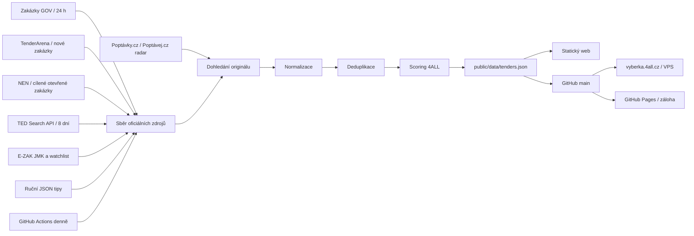

# Architektura a provoz

## Tok dat

## Provozní rozhodnutí

- **Bez databáze:** několik stovek otevřených tipů se bezpečně vejde do verzovaného JSON. Historie změn je přímo v Gitu a hosting nemá serverovou část.
- **Bez tajných klíčů:** hlavní zdroje jsou veřejné. První nasazení proto funguje bez správy secrets.
- **Překryv TEDu:** dotaz sahá osm dní zpět, aby krátký výpadek workflow nevytvořil mezeru. Deduplikace zabrání opakovanému publikování.
- **Český agregátor:** Zakázky GOV uvádí zakázky z různých systémů na jednom místě a poskytuje stručný popis, zadavatele, publikaci a lhůtu.
- **Fail-safe:** když oficiální zdroje nevrátí žádnou použitelnou položku, agent skončí chybou a nepřepíše data prázdným souborem. Při výpadku jednotlivého zdroje použije ostatní a stav zapíše do `sources`. Neplatný jednotlivý řádek přeskočí a započte do diagnostiky.
- **Termíny:** prošlé zakázky se nezobrazují. Chybějící termín se nepočítá mezi blížící se lhůty; česká data se převádějí podle letního nebo zimního času a čas se v přehledu ukazuje jen tehdy, když ho zdroj skutečně uvedl.
- **Agregátory nejsou autorita:** Poptávky.cz a Poptávej.cz pouze vytvoří lead. Odkaz se musí otevřít a přečíst nebo se lead musí jednoznačně spojit s již načteným oficiálním záznamem. Teprve údaje oficiálního záznamu se bodují a publikují. Nedohledané tipy čekají mimo web na další pokus.

## Denní běh

Workflow běží v 04:20 UTC (v Praze podle sezóny 05:20 nebo 06:20). Pořadí:

1. čistá instalace a testy,
2. načtení zdrojů,
3. spojení s existující historií,
4. vyřazení starých kandidátů, přečtení nových věcných příloh a přepočet relevance,
5. commit pouze při změně dat,
6. server synchronizuje nová data a web z GitHubu do minuty; GitHub Pages zůstává záložním výstupem.

Workflow lze kdykoli spustit ručně v záložce Actions. Díky `concurrency` se dva denní běhy nepřepisují.

## Deduplikace

První klíč je `source + sourceId`. Druhý, mezizdrojový klíč je SHA-256 fingerprint z normalizovaného názvu zadavatele, názvu zakázky a dne lhůty. Při sloučení se zachová delší popis, CPV z obou zdrojů, nejstarší `firstSeenAt` a seznam zdrojů.

## Budoucí rozšíření

- e-mailový nebo Slack digest jen pro skóre 75+,
- jednoduchá redakční vrstva (`nové / posoudit / go / no-go`),
- LLM druhý průchod nad zadávací dokumentací až po levném pravidlovém filtru,
- sběr z placeného zdroje přes nový adaptér v `src/sources/`,
- zpětná vazba z vyhraných/prohraných příležitostí pro kalibraci vah.

## Zpracování a diagnostika od 24. 10. 2026

- `data/radar-leads.json` uchovává také výsledky dohledání: `pending`, `resolved`,
  `rejected`, `expired`, `needs-verification`. Vyřazení má důvod a není čekáním.
  Relevantní komerční tip bez ověřeného zadavatele je viditelný k doplnění zdroje;
  agregátor se tím nestává autoritou a tip se nezveřejní jako ověřená zakázka.
- `data/review-queue.json` uchovává kandidáty, historii pokusů, otisk podkladů,
  další termín pokusu a jednoznačné stavy. Úspěch uzavírá čekání. Po třech
  neúspěšných pokusech následuje věcná kontrola; změna podkladů/pravidel dovolí
  nový pokus. Nejdéle nezkoušené položky mají přednost, limit je osm za běh.
- Platná ruční kontrola má přednost. Stará ruční kontrola jiných příloh nesmí
  přepsat novější automatický výsledek. Verze extrakce umožňuje přehodnocení
  po opravě pravidel. Částečná extrakce zachová doložená fakta i upozornění,
  ale neuzavírá kontrolu chybějících podkladů.
- PDF, DOCX, XLSX a ZIP se čtou bez spouštění obsahu; tabulky používají jen
  uložené hodnoty, nikdy nepočítají makra ani externí odkazy. Starý DOC/RTF
  a obrazové PDF bez textu vyžadují doplnění čitelného podkladu. Administrativní
  formuláře a duplicitní podepsané kopie nespotřebovávají limit věcných příloh.
- NEN a stahování příloh opakují přechodné síťové chyby s odstupem. Dílčí
  výpadky NEN jsou vidět ve výsledku. Vyčerpané pokusy označí workflow chybou
  až po uložení úspěšně zpracovaných dat.
- `processing` v publikovaném JSON zpřístupňuje stav v obou webových přehledech.
  Ukazuje i rozdíl mezi novým tipem a aktualizací zveřejněné zakázky. Výpadek
  sběru nelze zaměnit za aktuální prázdný seznam; web upozorní i na stáří dat.
- `assessment` odděluje oborové skóre od podkladů pro obchodní rozhodnutí:
  doložený rozpočet, kvalifikaci, hodnocení a chybějící informace. Náklady,
  marže, kapacity a vlastní reference se bez interních dat neodhadují.
  Rozporuplné rozpočty se automaticky neslučují.
- Denní rozvrh zůstává 04:20 UTC. E-mailový digest stále vyžaduje vlastní
  nastavení Resend a adresátů; nová diagnostika je dostupná přímo na webu
  a v souhrnu běhu GitHub Actions i bez této integrace.

### Trvalé opakování nedostupných detailů NEN (25. 10. 2026)

`sources[nen].retryQueue` v uloženém `tender-state.json` uchovává kód,
název, základní údaje z vyhledávání, první chybu, poslední pokus a počet
neúspěšných běhů. Další sběr načítá tyto detaily přímo; nemusí se znovu
objevit mezi prvními 80 výsledky hledání. Zkouší až 20 uložených adres navíc,
nejdéle nezkoušené mají přednost. Adresy se sestavují z validovaného kódu NEN.
Úspěšně přečtený detail pokračuje běžným vyhodnocováním a z fronty zmizí;
neúspěšné i dosud nezkoušené adresy zůstávají uložené. Technické výpadky NEN
se zkoušejí i po třetím neúspěšném běhu. Limit tří pokusů při věcném čtení
příloh je od této fronty oddělený. Starší chyby uložené jen jako varování se
jednorázově převedou do fronty. Ve webovém přehledu má každý takový detail
svůj stav, odkaz, počet pokusů a důvod; výpadek NEN neblokuje ostatní zdroje.
